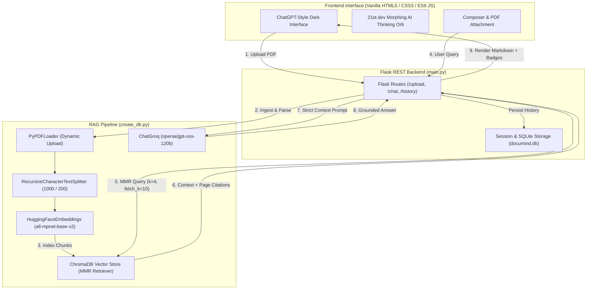

# DocuMind

Chat with your PDFs. Upload a document, ask questions, and get answers grounded in the text, with page citations.

DocuMind is a Retrieval-Augmented Generation (RAG) app with a Flask backend, a ChromaDB vector store, and a ChatGPT-style dark interface.

## Features

- Upload a PDF directly from the chat composer
- Answers grounded strictly in the document's content
- Page citation badges on every answer
- MMR retrieval for diverse, non-redundant context
- Persistent chat history stored in SQLite
- Markdown rendering for responses
- Animated "thinking" orb while the model responds

## Architecture



## Tech Stack

| Layer | Technology |
|---|---|
| Frontend | Vanilla HTML5, CSS3, ES6 JavaScript |
| Backend | Flask (REST) |
| Storage | SQLite (`documind.db`) |
| PDF loading | LangChain `PyPDFLoader` |
| Chunking | `RecursiveCharacterTextSplitter` (size 1000, overlap 200) |
| Embeddings | HuggingFace `all-mpnet-base-v2` |
| Vector store | ChromaDB (MMR retriever, `k=4`, `fetch_k=10`) |
| LLM | Groq, `openai/gpt-oss-120b` |

## Getting Started

### Prerequisites

- Python 3.10+
- A [Groq API key](https://console.groq.com/)

### Installation

```bash
git clone https://github.com/<your-username>/documind.git
cd documind

python -m venv venv
source venv/bin/activate        # Windows: venv\Scripts\activate

pip install -r requirements.txt
```

### Configuration

Create a `.env` file in the project root:

```env
GROQ_API_KEY=your_groq_api_key_here
```

### Run

```bash
python main.py
```

Then open http://localhost:5000 in your browser.

## API Endpoints

| Method | Route | Description |
|---|---|---|
| POST | `/upload` | Upload a PDF; it is parsed, chunked, embedded, and indexed |
| POST | `/chat` | Send a question; returns a grounded answer with page citations |
| GET | `/history` | Fetch the saved chat history for the session |

## How It Works

1. **Ingest:** the uploaded PDF is loaded page by page, split into 1000-character chunks with 200 overlap, and embedded with `all-mpnet-base-v2`.
2. **Index:** chunks and their page metadata are stored in ChromaDB.
3. **Retrieve:** each question runs an MMR search, fetching 10 candidates and keeping the 4 most relevant and diverse.
4. **Generate:** the retrieved context goes to the LLM with a strict prompt that limits answers to the document.
5. **Respond:** the answer is rendered as Markdown with page badges, and the exchange is saved to SQLite.

## Project Structure

```
documind/
├── main.py            # Flask app and routes
├── create_db.py       # RAG pipeline: load, split, embed, index
├── documind.db        # SQLite chat history (generated)
├── templates/         # HTML
├── static/            # CSS and JS
├── requirements.txt
└── .env               # API keys (not committed)
```

## Notes

- Add `.env`, `documind.db`, and your ChromaDB folder to `.gitignore`.
- Answers are limited to what the uploaded PDF contains; if the document doesn't cover a question, the model should say so.

## License

MIT
