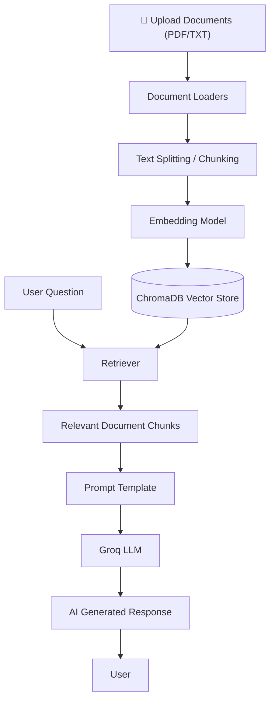

# 🎓 CourseMate AI


### Your AI-powered personal study assistant.

CourseMate AI is an intelligent learning assistant designed to make studying easier, faster, and more interactive. It uses Large Language Models (LLMs) and Retrieval-Augmented Generation (RAG) to help students understand their study materials, summarize documents, and get answers to academic questions.

---

## 🚀 Features

- **AI Question Answering:** Ask questions and receive intelligent, context-aware answers.
- **Document Summarization:** Generate concise summaries of lengthy study materials and PDF documents.
- **RAG-Based Retrieval:** Upload your notes and documents and get answers based on their actual content.
- **Personalized Learning:** Get explanations and learning assistance tailored to your questions and study materials.
- **Document Understanding:** Process and retrieve relevant information from uploaded study resources.

## 🏗️ System Architecture



## 🔄 How It Works

CourseMate AI follows a Retrieval-Augmented Generation workflow:

1. **Document Upload:** Students provide study materials and PDF documents.
2. **Document Loading:** Extract text from uploaded documents.
3. **Text Splitting:** Divide large documents into smaller chunks.
4. **Embedding Generation:** Convert text chunks into numerical vectors.
5. **Vector Storage:** Store embeddings in ChromaDB.
6. **Retrieval:** Retrieve relevant information based on user queries.
7. **Response Generation:** Pass retrieved context to the Groq LLM.
8. **AI Response:** Generate context-aware answers.

## 🛠️ Tech Stack

| Technology | Purpose |
|---|---|
| Python | Core programming language |
| LangChain | LLM application framework |
| Groq API | LLM inference |
| ChromaDB | Vector database |
| Sentence Transformers | Text embeddings |
| PyPDF | PDF document processing |
| FastAPI | Backend API |
| Uvicorn | ASGI server |
| Streamlit | User interface (planned) |

## 📂 Project Structure

```text
CourseMate-AI/
│
├── document loaders/
│   ├── GRU.pdf
│   ├── notes.txt
│   └── test.py
│
├── main.py
├── requirements.txt
├── README.md
└── .gitignore
```

## ⚙️ Installation & Setup

### 1. Clone the Repository

```bash
git clone https://github.com/Sarthak-Kumar-6843/CourseMate-AI.git
```

### 2. Navigate to Project Directory

```bash
cd CourseMate-AI
```

### 3. Create Virtual Environment

```bash
python -m venv .venv
```

### 4. Activate Virtual Environment

Windows:

```bash
.venv\Scripts\activate
```

### 5. Install Dependencies

```bash
pip install -r requirements.txt
```

### 6. Configure Environment Variables

Create a `.env` file:

```env
GROQ_API_KEY=your_groq_api_key
```

Get your API key from [Groq Console](https://console.groq.com/keys).

## 🎯 Project Goals

The primary goal of CourseMate AI is to build an intelligent learning companion that helps students interact with their own study materials rather than manually searching through lengthy documents.

By combining RAG, LLMs, and semantic search, CourseMate AI aims to make learning more accessible, efficient, and personalized.

## 🚧 Development Status

Currently under development.

More features and improvements will be added as development progresses.

---

### ⭐ CourseMate AI

**Learn Smarter, Not Harder.**
